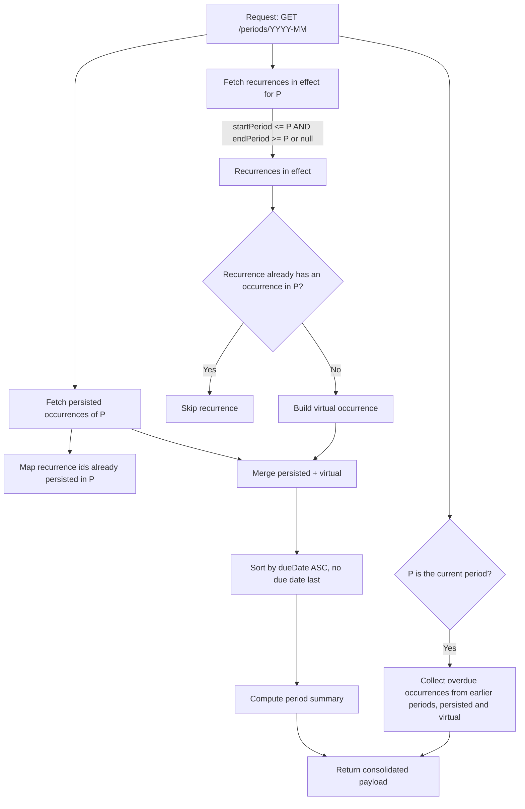

# Product Requirements Document (PRD)

## Mensal: Minimalist Monthly Cash-Flow Tracker

> Vocabulary follows [`GLOSSARY.md`](../GLOSSARY.md). Code, data and docs are in English; only the user interface is in Brazilian Portuguese.

---

## 1. Overview and Value Proposition

### 1.1 Context and Problem

Most personal-finance tools overdo it: complex spreadsheets, deep categorization and dozens of charts that create daily data-entry friction. Individuals usually want to answer only two questions at the start of each month:

1. _Which bills are due this month, and how much of my salary will be left?_
2. _Has this specific bill been paid yet, or is it still pending?_

### 1.2 Value Proposition

A **minimalist, opinionated** SaaS focused strictly on forecasting and settling monthly cash flow. The system anticipates commitments through recurrences and lets the user review and settle occurrences directly, without bureaucratic configuration.

### 1.3 Non-Goals (MVP)

- Periodicity other than monthly. Annual bills are one-off occurrences; installments are recurrences with an `endPeriod`.
- Balances, categories, multiple currencies. Amounts are always BRL. The only chart is the trend of §7.11.
- Billing or paid plans.
- Email beyond the transactional password and account-deletion emails of §8.2 ([ADR-0003](adr/0003-transactional-email-via-resend.md)): no verification, approval notices or notifications.
- Internationalization: the UI is Brazilian Portuguese only.
- Offline use: the installed app opens without a connection but stays locked until it is back; no data is cached or queued offline (§7.16, [ADR-0006](adr/0006-app-shell-service-worker-no-offline-data.md)).
- OAuth for agents (e.g. claude.ai custom connectors): agents connect to the MCP server with access tokens only (§8.9, [ADR-0004](adr/0004-remote-mcp-with-access-tokens.md)).
- Reminders by email, SMS or any channel other than Web Push: Mensal reminds by push, once a day, on the devices where the user turned reminders on (§6.8, [ADR-0009](adr/0009-reminders-through-web-push-and-a-daily-job.md)). The user's own calendar can also remind them, through the calendar link (§6.6, §6.7, [ADR-0008](adr/0008-reminders-through-a-subscribed-calendar-link.md)). No other scheduled job.

---

## 2. Key Design Decisions

| Problem                                         | Risk                                                                                                           | Decision                                                                                                                                           |
| :---------------------------------------------- | :------------------------------------------------------------------------------------------------------------- | :------------------------------------------------------------------------------------------------------------------------------------------------- |
| **One-off expenses**                            | Not every expense recurs (car repair, a doctor's visit). Forcing a recurrence creates "throwaway recurrences". | `recurrenceId` on `Occurrence` is nullable. When null, it is a **one-off occurrence**.                                                             |
| **Invalid due days (February / 30-day months)** | A recurrence due on the 31st breaks in February or April.                                                      | _Clamping_: the effective day is `min(dueDay, daysInMonth(period))`.                                                                               |
| **Destructive cascade delete**                  | Deleting a recurrence and its past occurrences destroys settled history.                                       | A recurrence with persisted occurrences cannot be deleted, only **ended**.                                                                         |
| **Redundant statuses**                          | `SKIPPED` and `CANCELLED` had the same effect.                                                                 | Only `PENDING`, `SETTLED`, `SKIPPED`. Cancelling a one-off is deleting it; cancelling a recurrence is ending it. Overdue is derived, never stored. |
| **Settlement date vs period**                   | Only knowing the period hides when, or how late, a bill was actually paid.                                     | Optional `settledAt` date. Totals are always grouped by period, never by `settledAt`.                                                              |
| **Time zones**                                  | Storing periods as UTC timestamps can shift `2026-05-01` into the previous month for `-03:00` clients.         | Periods are stored as `DATE` (no time), always the 1st (`YYYY-MM-01`). "Today" is always computed in `America/Sao_Paulo`.                          |
| **Generating future months**                    | Pre-creating occurrences needs a scheduled job and goes stale whenever a recurrence is edited.                 | **Virtual occurrences** are projected at read time and materialized on first touch. See [ADR 0001](./adr/0001-virtual-occurrences.md).             |
| **Forgotten past bills**                        | An unpaid bill from last month is invisible unless the user navigates back.                                    | When viewing the current period, overdue occurrences from previous periods are listed too, outside the summary.                                    |

---

## 3. Domain Model and Data

Tables are plural. Columns are `snake_case` in the database and `camelCase` in TypeScript and JSON; Drizzle maps them with `casing: 'snake_case'`. Amounts are integers in BRL cents (R$ 50,00 → `5000`). App ids are `uuid DEFAULT gen_random_uuid()`; Better-Auth ids keep its default (text).

### 3.1 Entity: Recurrence (`recurrences`)

The monthly commitment that projects one occurrence per period.

```typescript
type Direction = 'INFLOW' | 'OUTFLOW';

interface Recurrence {
  id: string;                   // uuid
  userId: string;               // FK users.id, ON DELETE CASCADE
  direction: Direction;         // Immutable after creation
  description: string;          // Max 120 characters
  defaultAmount: number | null; // Cents, > 0 when present. Null for variable bills (e.g. credit card statement)
  dueDay: number | null;        // 1 to 31. Optional
  startPeriod: string;          // 'YYYY-MM-01'. Immutable. Must be >= current period at creation
  endPeriod: string | null;     // 'YYYY-MM-01', inclusive. Null = open-ended. Must be >= startPeriod
  notes: string | null;
  createdAt: string;            // ISO 8601 UTC
  updatedAt: string;            // ISO 8601 UTC
}
```

There is no `active` flag. A recurrence is **active** when `endPeriod IS NULL OR endPeriod >= currentPeriod`, which includes recurrences starting in the future.

### 3.2 Entity: Occurrence (`occurrences`)

An inflow or outflow in a specific period.

```typescript
type OccurrenceStatus = 'PENDING' | 'SETTLED' | 'SKIPPED';

interface Occurrence {
  id: string;                  // uuid
  userId: string;              // FK users.id, ON DELETE CASCADE
  recurrenceId: string | null; // Null for one-off occurrences
  direction: Direction;        // Snapshot of the recurrence at materialization
  description: string;         // Snapshot of the recurrence, or set at creation
  status: OccurrenceStatus;
  amount: number | null;       // Cents, > 0 when present. Null = "to be defined"
  period: string;              // 'YYYY-MM-01'
  dueDate: string | null;      // 'YYYY-MM-DD', must fall within period
  settledAt: string | null;    // 'YYYY-MM-DD'. Non-null if and only if status = SETTLED
  notes: string | null;
  createdAt: string;
  updatedAt: string;
}
```

Database constraints:

- `UNIQUE (user_id, recurrence_id, period) WHERE recurrence_id IS NOT NULL`
- `CHECK (amount IS NULL OR amount > 0)`
- `CHECK (status <> 'SETTLED' OR amount IS NOT NULL)`
- `CHECK ((status = 'SETTLED') = (settled_at IS NOT NULL))`
- `CHECK (due_date IS NULL OR date_trunc('month', due_date) = period)`

### 3.3 Transient Object: Virtual Occurrence

Built in memory and returned by the API for a recurrence that has no persisted occurrence in the requested period:

```typescript
interface VirtualOccurrence {
  id: string;                  // Deterministic: 'virtual_<recurrenceId>_<period>'
  recurrenceId: string;
  isVirtual: true;
  direction: Direction;
  description: string;         // Current recurrence description
  status: 'PENDING';
  amount: number | null;       // Current recurrence defaultAmount
  period: string;
  dueDate: string | null;      // Clamped from dueDay
  settledAt: null;
  notes: null;
}
```

A virtual occurrence always reflects the recurrence as it is **now**. Editing a recurrence changes all its virtual occurrences, past and future. Only persisted occurrences keep a snapshot.

### 3.4 User Approval

Sign-up is open, but a new user cannot use the product until an administrator approves them.

- Better-Auth `user.additionalFields.approved`: `boolean`, default `false`, `input: false` (so it cannot be set on sign-up).
- The administrator approves users by setting `approved = true` directly in the database.
- No email verification is required.

### 3.5 Preferences

A user's preferences belong to the account, not the device: every browser they sign in on uses the same values ([ADR-0002](adr/0002-preferences-on-auth-user.md)).

| Preference             | Type                          | Default  | Effect                                                                                                                               |
| ---------------------- | ----------------------------- | -------- | ------------------------------------------------------------------------------------------------------------------------------------ |
| `showSummary`          | `boolean`                     | `true`   | Shows the summary bar on the monthly screen. Closing the bar turns it off.                                                           |
| `confirmStatusChanges` | `boolean`                     | `true`   | Asks for confirmation before settling, skipping or taking an occurrence back to `PENDING`.                                           |
| `colorScheme`          | `"dark" \| "light" \| "auto"` | `"dark"` | The app's theme (Tema): Escuro, Claro, or Automático, which follows the device's own setting, live. Any other value is rejected.     |
| `occurrenceView`       | `"list" \| "table"`           | `"list"` | How the monthly screen shows its occurrences (Visualização): Lista, the grouped list, or Tabela (§7.9). Any other value is rejected. |

- Each is a Better-Auth `user.additionalFields` entry with `input: true`, so it travels with the session and is written by Better-Auth's `update-user` endpoint. `approved` stays `input: false` and cannot be written that way.
- The UI applies a change at once and saves it in the background, rolling back on failure. Other open devices pick the change up the next time they reload the session (on window focus); there is no live push.
- Before the session is known (first paint, and the signed-out screens), each device uses the last theme it applied, or Escuro if it has none. That copy is only a cache: once the session loads, the account's value wins, and the cache is never sent at sign-up.

---

## 4. Period Resolution Algorithm

To render period $P$ (`YYYY-MM-01`):



This logic is a pure function in `@shared` (`resolvePeriod`) that takes the persisted occurrences, the recurrences, the period and "today". The API only fetches data and calls it.

### Due Date Clamping

When an occurrence is projected from `dueDay`:

$$\text{effectiveDay} = \min(\text{recurrence.dueDay}, \text{daysInMonth}(P))$$
$$\text{dueDate} = \text{format}(P.\text{year}, P.\text{month}, \text{effectiveDay})$$

If `dueDay` is `null`, the occurrence has no `dueDate`.

### Summary

`SKIPPED` occurrences are excluded from every total. For each direction (`INFLOW`, `OUTFLOW`):

- **expected** = sum of `amount` over `PENDING` and `SETTLED` occurrences, persisted and virtual. A null amount counts as 0.
- **settled** = sum of `amount` over `SETTLED` occurrences only.

Overdue occurrences from earlier periods do **not** enter the summary of the current period.

The API returns no balance. Any difference between inflows and outflows is computed by the client.

### Overdue from Earlier Periods

Only when $P$ is the current period, the payload also lists every overdue occurrence from earlier periods:

- persisted `PENDING` occurrences with `dueDate < today`;
- virtual occurrences of earlier periods (within each recurrence's `startPeriod`..`endPeriod`) with `dueDate < today`.

---

## 5. Business Rules

1. **One occurrence per recurrence per period:** enforced by the partial unique index in 3.2.
2. **Materialization on first touch:**
   - Any mutation of a virtual occurrence (status, amount, due date, notes) materializes it. A write that changes nothing is no mutation: the occurrence stays virtual and comes back as it is.
   - The API accepts the virtual id on `PATCH /occurrences/:id` and `PATCH /occurrences/:id/status` and performs an idempotent upsert (`INSERT ... ON CONFLICT` on the unique index). It copies `direction`, `description`, `defaultAmount` and the clamped `dueDate` from the recurrence.
3. **Snapshot on materialization:** editing a recurrence never changes persisted occurrences. A `defaultAmount` change in June leaves May's persisted occurrence untouched.
4. **Deleting and ending a recurrence:**
   - Without persisted occurrences: hard delete.
   - With persisted occurrences: `DELETE` returns `409 RECURRENCE_HAS_OCCURRENCES` and the client offers to **end** the recurrence instead.
   - Ending asks the user for the last period (inclusive), **defaulting to the current period**.
   - Ending deletes nothing. Persisted occurrences stay as they are, even those after `endPeriod`. Virtual occurrences are no longer projected after `endPeriod`.
5. **Overdue (derived):** there is no `OVERDUE` status in the database. API and client compute:
   $$\text{overdue} = (\text{status} = \text{PENDING}) \land (\text{dueDate} \neq \text{null}) \land (\text{dueDate} < \text{today})$$
   - Occurrences without a `dueDate` are never overdue.
   - "Today" is always computed in `America/Sao_Paulo` (shared helper in `@shared`).
6. **Variable amounts:** when `defaultAmount` is null, the occurrence shows the amount as "to be defined". It can be persisted with a null amount (for example when skipped, or when only the due date changes). It can only be settled after an amount greater than zero is entered.
7. **Status transitions:** any transition between `PENDING`, `SETTLED` and `SKIPPED` is allowed, as long as the invariants hold:
   - `SETTLED` requires `amount > 0` (`AMOUNT_REQUIRED_TO_SETTLE`). `settledAt` defaults to today when not given.
   - Leaving `SETTLED` clears `settledAt`.
8. **Editable occurrence fields:** `description`, `amount`, `dueDate` (within the period), `settledAt` (only when `SETTLED`) and `notes`. `direction`, `period` and `recurrenceId` are immutable. To move a one-off occurrence to another period, delete it and create it again.
9. **One-off occurrences:** created directly, and they can be hard-deleted. Occurrences that came from a recurrence cannot be deleted; they are skipped instead.
10. **Recurrence start:** `startPeriod` cannot be earlier than the current period. Earlier history is entered as one-off occurrences.
11. **Ordering:** by `dueDate` ascending; occurrences without a `dueDate` come **last**.
12. **Tenant isolation:** every query is filtered by `userId`.
13. **Account deletion:** deleting a user ([ADR-0005](adr/0005-immediate-hard-account-deletion.md)) is immediate and permanent. It cascades to all of their recurrences, occurrences, sessions, accounts, calendar link and reminder devices (§6.8), and their access tokens are deleted just before it (the `apikeys` table has no foreign key to `users`). Nothing is kept: the same email can sign up again as a new user, who needs approval again.

---

## 6. API Contracts (Express)

All routes under `/api/v1` require an authenticated, approved user (see 8.2). Errors carry an English machine-readable `code`, which the frontend translates into Portuguese. Examples: `USER_NOT_APPROVED`, `RECURRENCE_HAS_OCCURRENCES`, `AMOUNT_REQUIRED_TO_SETTLE`, `DUE_DATE_OUTSIDE_PERIOD`, `START_PERIOD_IN_PAST`, `ONLY_ONE_OFF_DELETABLE`.

### 6.1 Recurrences (`/api/v1/recurrences`)

- `GET /`: lists the user's recurrences (`?status=active|all`, as defined in 3.1).
- `POST /`: creates a recurrence.
- `GET /:id`: details of one recurrence.
- `PATCH /:id`: updates `description`, `defaultAmount`, `dueDay`, `endPeriod` and `notes`. Rejects changes to `direction` and `startPeriod`. Ending a recurrence is a `PATCH` of `endPeriod`.
- `DELETE /:id`: hard delete when no persisted occurrences exist; otherwise `409 RECURRENCE_HAS_OCCURRENCES` (rule 5.4).

### 6.2 Periods (`/api/v1/periods`)

- `GET /:yyyy-mm` (e.g. `2026-10`): returns persisted and virtual occurrences merged, the summary, and (current period only) overdue occurrences from earlier periods:

  ```json
  {
    "period": "2026-10-01",
    "summary": {
      "inflowExpected": 650000,
      "inflowSettled": 650000,
      "outflowExpected": 420000,
      "outflowSettled": 280000
    },
    "items": [
      {
        "id": "0b6f6c1e-7a51-4d1a-9a8e-3f1f4c2d9b10",
        "isVirtual": false,
        "recurrenceId": "5d2c8a4b-1e3f-4b6a-8c9d-2a7e6f1b3c40",
        "direction": "OUTFLOW",
        "description": "Aluguel",
        "status": "SETTLED",
        "amount": 220000,
        "period": "2026-10-01",
        "dueDate": "2026-10-10",
        "settledAt": "2026-10-09",
        "overdue": false
      },
      {
        "id": "virtual_9e1d3b7a-4c2f-4e8b-b6a1-7f3c2d1e0a99_2026-10-01",
        "isVirtual": true,
        "recurrenceId": "9e1d3b7a-4c2f-4e8b-b6a1-7f3c2d1e0a99",
        "direction": "OUTFLOW",
        "description": "Energia Elétrica",
        "status": "PENDING",
        "amount": 18000,
        "period": "2026-10-01",
        "dueDate": "2026-10-25",
        "settledAt": null,
        "overdue": false
      }
    ],
    "overdueFromPreviousPeriods": []
  }
  ```

### 6.3 Occurrences (`/api/v1/occurrences`)

- `POST /`: creates a one-off occurrence.
- `PATCH /:id/status`: changes the status (rule 5.7) and adjusts `settledAt`. Accepts a virtual id and materializes it (rule 5.2).
- `PATCH /:id`: updates the editable fields (rule 5.8). Accepts a virtual id and materializes it.
- `DELETE /:id`: hard-deletes a one-off occurrence; otherwise `409 ONLY_ONE_OFF_DELETABLE`.

### 6.4 Summaries (`/api/v1/summaries`)

- `GET /?from=yyyy-mm&to=yyyy-mm` (e.g. `?from=2026-05&to=2026-10`): the summary (§4) of every period from `from` to `to`, both inclusive, in ascending order. Requires `from <= to` and at most 12 periods, otherwise `400 INVALID_PERIOD_RANGE`; a malformed month is `400 INVALID_PERIOD`. Every period of the range is present, with zeros when it has no occurrences. Overdue occurrences from earlier periods never enter any summary, as in §4. Read-only: it never materializes a virtual occurrence.

  ```json
  {
    "items": [
      {
        "period": "2026-05-01",
        "summary": {
          "inflowExpected": 650000,
          "inflowSettled": 650000,
          "outflowExpected": 420000,
          "outflowSettled": 410000
        }
      }
    ]
  }
  ```

### 6.5 Data download (`/api/v1/data`)

- `GET /`: the user's own data as `200 application/zip`, with `Content-Disposition: attachment; filename="mensal-dados-AAAA-MM-DD.zip"` (today in `America/Sao_Paulo`). Read-only: it never materializes a virtual occurrence. Built by a domain operation that takes the user id and returns the ZIP as a stream and knows nothing of HTTP, so a background job can build it later without changing the archive.
- The archive holds only what the user entered, as three CSV files in the dialect of §7.10 (UTF-8 with a BOM, `;` separator, CRLF, the same quoting, amounts as `1234,56`, empty when absent, dates as `DD/MM/AAAA`). Every file is present even when it has no rows, with its header only.
  - `perfil.csv`: `Nome;Email;Criado em`, one row.
  - `recorrencias.csv`: `ID;Descrição;Tipo;Valor;Dia de vencimento;Início;Fim;Notas`, every recurrence, ended ones included, ordered by `createdAt`. Início and Fim are `AAAA-MM` (Fim empty when open-ended); Valor is the default amount.
  - `ocorrencias.csv`: `ID;Competência;Descrição;Vencimento;Tipo;Valor;Situação;Liquidada em;Origem;Recorrência (ID);Notas`, every persisted occurrence (virtual ones are not data the user entered; the recurrences rebuild them), ordered by `period` then as in §5.11. Competência is `AAAA-MM`; Recorrência (ID) is empty for a one-off.
- Preferences, approval, sessions, access tokens, the calendar link and reminder devices (§6.8) are not included.

### 6.6 Calendar link (`/api/v1/calendar-link`)

The user's calendar link: a secret, read-only address of the feed of §6.7 ([ADR-0008](adr/0008-reminders-through-a-subscribed-calendar-link.md)). It is not an access token: it only reads the feed and is valid nowhere else. A user has at most one.

- `GET /`: `200 { "link": { "url": "https://…/api/calendar.ics?key=…", "createdAt": "…" } }`, or `{ "link": null }` when the user has none. The URL is built on the app's public origin, and is shown again whenever the user opens the screen, since they need it to subscribe on another device.
- `POST /` with `{ "password" }`: generates a new link, replacing the current one, which stops working at once. Requires the current password (`400 INVALID_PASSWORD`), so a stolen session alone cannot mint a lasting address. Answers `201` with the same body as `GET`.
- `DELETE /`: deactivates the link; `204`, also when there is none. No password is asked.
- Cookie-only, under the same approval gate as the rest of `/api/v1`. Agents cannot manage the link: there is no MCP tool for these routes (§8.9).
- **Storage:** a `calendar_links` table: `user_id` (primary key, FK `users.id`, `ON DELETE CASCADE`), `key` (unique; 32 random bytes as base64url) and `created_at`. The key is stored in plain text: anyone who can read the database already reads the data the link exposes. It is not a Better-Auth `additionalFields` entry, so it never travels with the session.
- A password reset deactivates the link, and a password change does when the user leaves the access-tokens box checked (§8.2).

### 6.7 Calendar feed (`/api/calendar.ics`)

- `GET /api/calendar.ics?key=<key>`: the user's pending occurrences as an iCalendar feed, for their calendar app to subscribe to. Outside `/api/v1`, with no cookie or session: the key is the only credential. It travels in the query string, never the path, because telemetry drops query strings and keeps paths (§8.7.2).
- A missing, unknown or deactivated key answers `404` with no body. A key whose owner is not approved answers `403 USER_NOT_APPROVED`, checked on every request. Each link may be read 60 times per hour; above it, `429`.
- Success is `200 text/calendar; charset=utf-8` with `Cache-Control: no-store`. Read-only: it never materializes a virtual occurrence.
- **Calendar:** named "Mensal" (`X-WR-CALNAME`), with `X-WR-TIMEZONE:America/Sao_Paulo` for information only: every event is all-day.
- **Which occurrences:** every `PENDING` occurrence with a due date, persisted and virtual, inflows and outflows. The feed covers the overdue occurrences from earlier periods (as §4 lists them), the current period and the next 3 periods. Settled and skipped occurrences, and those without a due date, are left out. An overdue occurrence stays on its own due date; it is never moved to today.
- **Event:** all-day on the due date (`DTSTART;VALUE=DATE`, `DTEND` the next day).
  - `SUMMARY`: `<description> · R$ 230,00`, or `<description> · A definir` when the amount is null; inflows are prefixed with `Entrada: `.
  - `DESCRIPTION`: the period ("Competência: outubro de 2026") and a link to that month in the app. Notes are never included.
  - One `VALARM` (`ACTION:DISPLAY`) at 09:00 on the due date (`TRIGGER:PT9H`), fixed.
  - `UID`: `<recurrenceId>_<period>@mensal` for a recurrence's occurrence, virtual or persisted, so materializing it keeps the same event; `<id>@mensal` for a one-off. `LAST-MODIFIED` is the occurrence's `updatedAt` (the recurrence's for a virtual one), and `SEQUENCE` is derived from it, so it grows with each edit.
- **What the user must know** (stated on the screen of §7.18 and in the guide): Google Calendar and Outlook ignore the feed's alarm, and Apple Calendar removes it unless "Remover alertas" is turned off when subscribing. Calendars refresh on their own schedule (Google about every 8–24 hours, with no way to force it), so a settled or skipped occurrence can stay in the calendar, and still remind, until the next refresh.

### 6.8 Reminders (`/api/v1/reminders`)

Once a day Mensal sends each approved user one reminder, by Web Push, to every device on which they turned reminders on ([ADR-0009](adr/0009-reminders-through-web-push-and-a-daily-job.md)). Reminders are turned on per device, never account-wide, and are not a preference (§3.5). A **reminder device** is one browser's push registration: its push service endpoint and keys, as the browser's `PushManager` hands them out.

- `GET /`: `200 { "publicKey": "…", "deviceCount": 2 }`. `publicKey` is the server's VAPID public key, for the browser to register with, or `null` when reminders are not configured on this server (§8.4). `deviceCount` is how many of the user's devices have reminders on.
- `PUT /device` with `{ "endpoint", "keys": { "p256dh", "auth" } }`: turns reminders on for the calling device. Idempotent on `endpoint`: an endpoint registered to another user is taken over, since holding it proves the caller is on that device. When the device was not already the user's, it is sent the confirmation of the next list. Answers `200 { "deviceCount": … }`. `409 REMINDERS_UNAVAILABLE` when reminders are not configured.
- `POST /device/check` with `{ "endpoint" }`: `200 { "mine": true | false }`. When the endpoint is registered to another user, that registration is deleted and the answer is `false`, so the client also drops the browser's own registration (§8.2). When it is the user's, the device is bound to the current session (see **Storage**).
- `DELETE /device` with `{ "endpoint" }`: turns reminders off for the calling device; `204`, also when it had none.
- `DELETE /`: turns reminders off on every device of the user; `204`.
- Endpoints travel in the body, never the URL: an endpoint is a capability URL, and nginx logs query strings.
- Cookie-only, under the same approval gate as the rest of `/api/v1`. Agents cannot manage reminders: there is no MCP tool for these routes (§8.9).
- **Storage:**
  - A `reminder_devices` table: `id` (uuid), `user_id` (FK `users.id`, `ON DELETE CASCADE`), `endpoint` (unique across users), `p256dh`, `auth`, `session_id` (the session that last registered or checked it, without a foreign key, so it outlives that session) and `created_at`. Stored in plain text: a registration only lets its holder send to that browser.
  - A `reminder_sends` table: `user_id` (FK, `ON DELETE CASCADE`) and `date`, together the primary key, plus `created_at`. One row per user per São Paulo day on which the job handled them.
- **The daily job:** runs inside the API process, not in a separate service. Every 5 minutes it checks whether it is 09:00 or later in `America/Sao_Paulo`. If so, it handles each approved user who has at least one device and no `reminder_sends` row for today. A run missed while the API was down is therefore caught up later the same day, never the next.
  - **At most once:** a user's `reminder_sends` row is inserted (`ON CONFLICT DO NOTHING`) before anything is sent, and only the run that inserted it sends. Replicas and restarts never send twice. A failed send is not retried.
  - **What it covers:** the user's `PENDING` occurrences, persisted and virtual, inflows and outflows, whose due date is today, and the overdue occurrences as §4 lists them for the current period. It is read-only: it never materializes a virtual occurrence. When both are empty, nothing is sent, and the day still counts as handled.
  - **Unapproved users** are skipped and their devices kept, so approving them again resumes their reminders.
  - **Dead devices:** a push service answering `404` or `410` deletes that device. Other failures are logged and the device kept.
  - A device that turns reminders on after the user was handled today gets its first reminder tomorrow.
- **The reminder** (pt-BR, end-to-end encrypted to the device, RFC 8291; the lock screen still shows it, so it never carries amounts or notes):
  - Title: `Vence hoje: <description>` for one occurrence due today, `<n> contas vencem hoje` for several, or `<n> contas atrasadas` (`1 conta atrasada`) when only overdue ones remain.
  - Body: up to 3 descriptions, the due-today ones first, then the overdue ones, joined as `Aluguel, Luz, Internet e mais 2`. When the title names occurrences due today and there are also overdue ones, a second line `+ <n> atrasadas`. An inflow's description is prefixed `Entrada: `, as in the calendar feed (§6.7).
  - A fixed `tag`, so a reminder replaces the previous one still on the screen instead of stacking. No action buttons.
  - Tapping it focuses an open app window, or opens one, at the current period.
- **The confirmation:** title `Lembretes ativados`, body `Todo dia às 9h, neste dispositivo, sobre as contas que vencem no dia e as atrasadas.` It proves the whole path works when the user turns reminders on, so there is no separate test button.
- **The push sink:** an injectable `push` option on the app, like `email` (§8.2). By default it signs with the VAPID keys of §8.4. API tests inject a capturing sink: nothing ever calls a real push service in tests.

---

## 7. Frontend and Minimalist UX

All UI text is Brazilian Portuguese, written directly in the components (no i18n library). Currency and dates are formatted with `Intl` (`pt-BR`, `BRL`). API error codes are mapped to Portuguese messages.

1. **Period navigator:** fixed month selector at the top (`< Outubro 2026 >`), moving back and forward with one click or the `←` / `→` keys. Away from the current period, a **Mês atual** button returns to it. Leaving for Recorrências and coming back via **Mês** keeps the month that was on screen (per tab, not saved; cleared on sign-out).
2. **Summary bar:** one dominant figure, **Sobra prevista** (expected inflows minus expected outflows, computed by the client), with two supporting blocks, **Entradas** and **Saídas**, each with **Previsto** and **Realizado**.
3. **One-click settle:** a checkbox or quick action on each row toggles between `PENDING` and `SETTLED`. If the amount is null, the click opens an inline popover asking only for the amount.
4. **Groups (in this order):**
   - **Atrasadas**, including overdue occurrences from earlier periods (current period only), each labeled with its period;
   - **Vencem hoje**;
   - **A vencer no mês**, with pending occurrences without a due date at the end;
   - **Liquidadas e puladas**.
5. **Optimistic UI:** status changes update the screen instantly through TanStack Query, with rollback on failure.
6. **Recurrences screen:** a second screen listing recurrences (filter active/all) with edit, end and delete actions. The same actions are reachable from an occurrence row.
7. **One-off and recurrence dialog:** creating a one-off occurrence or a recurrence from the monthly screen.
8. **Auth screens:** sign-up, sign-in, and an **"Aguardando aprovação"** screen (with sign-out) shown to unapproved users.
9. **Table view:** with the `occurrenceView` preference (§3.5) set to Tabela, the block of occurrences of the monthly screen is a table instead of the grouped list; the period navigator, summary bar and "Nova avulsa" do not change. A Lista / Tabela switch in the bar heading the occurrences (beside **Exportar CSV**) and a **Visualização** control in Configurações set it, applied at once and rolled back with a notice on failure; it holds while moving between months. The table has the columns checkbox, Descrição, Vencimento (`DD/MM/AAAA` or "Sem vencimento"), Tipo (Entrada / Saída), Valor, Situação (Atrasada, Vence hoje, A vencer, Liquidada, Pulada), Liquidada em, Origem (Avulsa / Recorrência), Notas (one line, full text on hover) and a row menu. Rows follow the list's group order, include the overdue occurrences of earlier periods on the current period, and mark Atrasada and Vence hoje with the "needs you" yellow. An empty period shows the list's empty-month message.
10. **CSV export:** **Exportar CSV** on the monthly screen downloads the period as `mensal-AAAA-MM.csv`, generated in the browser from the loaded period (no API route; it never materializes a virtual occurrence). Only the period's own occurrences, in the table's order; overdue occurrences of earlier periods are left out, so joining several months never counts one twice. UTF-8 with a BOM, `;` separator, CRLF line endings, header `Descrição;Vencimento;Tipo;Valor;Situação;Liquidada em;Origem;Notas`. Valor is the absolute amount as `1234,56` (no thousands separator or symbol; empty for "A definir"); dates are `DD/MM/AAAA` (empty when absent); Tipo is Entrada / Saída, Origem is Avulsa / Recorrência, Situação uses the table's labels. Fields containing `;`, `"`, CR or LF are quoted, with `"` doubled. No summary rows. The button is disabled when the period has no occurrences of its own.
11. **Trend (Evolução):** an icon button in the summary bar (accessible label "Evolução") opens a modal (full screen on phones) with the trend of the 3, 6 or 12 periods ending at the period on screen, inclusive, even when it lies in the future; the title shows the range (e.g. "Mai 2026 – Out 2026"). Range (default 6 meses) and chart type (default Linhas) are kept per tab, not saved, like the period on screen. Data comes from §6.4, refetched whenever an occurrence or recurrence changes. The modal does not navigate, and `←` / `→` do nothing while it is open.
    - **Main chart**, as lines or bars: Entradas Previsto and Realizado, Saídas Previsto and Realizado, and Sobra prevista. In bar mode Sobra prevista stays a line over the bars. Inflows are emerald, outflows rose, left over yellow (ink in the light scheme, per the Fill-Only Rule in DESIGN.md); Previsto is a solid line or a translucent bar, Realizado a dashed line or a solid bar. Realizado is left blank for periods after the current period.
    - **Sobra acumulada chart**, always a line: the running sum of Sobra prevista from zero at the first period of the range, computed by the client.
    - Both charts draw a zero line and, when the current period is in range, a vertical dashed marker, without a label, on it. The legend toggles each series. X axis `mai/26`; Y axis compact (`R$ 6,5 mil`); the tooltip lists every series of the month in full BRL, "—" for a blank Realizado. Periods without occurrences count as zero and are never trimmed.
    - A collapsible **Ver valores** table below the charts lists, per period, Competência, Entradas Previsto / Realizado, Saídas Previsto / Realizado, Sobra prevista and Sobra acumulada.
    - Loading shows skeletons; a failure shows a message with "Tentar novamente"; a range that is all zeros shows "Nenhuma conta nesses meses." instead of the charts.
12. **Access tokens (Tokens de acesso):** an item in the account menu, next to "Alterar senha" and separate from Configurações (a token is not a preference), opens the user's access tokens (§8.9).
    - The list shows each token's name, prefix, creation date and last use ("Nunca usado" when it has none), and each token can be revoked after a confirmation.
    - **Criar token** asks for a name and the current password. The full token is shown **once**, with a copy button and the message that it will not be shown again. Next to it are ready-to-copy snippets with the token and the app's public URL: the `claude mcp add --transport http …` command for Claude Code and the `[mcp_servers.mensal]` block of Codex's `~/.codex/config.toml`.
    - An empty list explains what a token is for and offers **Criar token**.
13. **Change name (Alterar nome):** an item in the account menu, before "Alterar senha" and separate from Configurações (a name is not a preference), opens a modal with a single **Nome** field holding the current name (§8.2). No password is asked. Saving an unchanged name closes it without a request; saving a new one closes it and the menu shows the new name at once, with no notice. A refused name is that field's error ("Informe um nome de até 100 caracteres."); any other failure is the form's. Other devices show the new name the next time they load the session.
14. **Download data (Baixar meus dados):** an item in the account menu downloads the archive of §6.5. While it is being built the item shows a loader; a failure shows a notice with "Tentar novamente".
15. **Delete account (Excluir conta):** an item at the end of the account menu, and a link on the "Aguardando aprovação" screen, open a modal that says the account and every recurrence, occurrence and access token, and the calendar link, will be erased for good, offers **Baixar meus dados** first (approved users only), and asks for the current password and the user's email typed as confirmation. The **Excluir conta** button stays disabled until the typed email matches. A wrong password is that field's error. On success the user lands on the sign-in screen with the notice "Sua conta foi excluída."; other devices are signed out with it (§8.2).
16. **Installable app, online only (PWA):** the app can be installed from the browser's own install UI (no in-app install button). It is a PWA whose service worker caches only the app shell ([ADR-0006](adr/0006-app-shell-service-worker-no-offline-data.md)), so an installed app opens without a connection, but no data is ever available offline.
    - **Manifest:** name and short name "Mensal", `lang` `pt-BR`, `display` `standalone`, `start_url` and `scope` `/`, `background_color` and `theme_color` `#0a0a0a` (the `theme-color` meta the app switches with the color scheme, §3.5, still wins while it runs). Icons are PNGs generated once from `logo.svg` and committed: 192 and 512 px, a 512 px maskable one on the canvas color with safe padding, and a 180 px `apple-touch-icon`.
    - **Service worker:** hand-written (Workbox `injectManifest`), it precaches the built shell (`index.html`, hashed assets, fonts, icons); navigations to client routes fall back to `index.html`. Nothing under `/api` is cached or answered by the fallback. It also shows reminders (`push`) and opens the app when one is tapped (`notificationclick`), §6.8. A new version installs and activates at once without a prompt or a reload: open tabs keep the shell they loaded and the next open gets the new one. It is registered only by the production build, never in development or tests, so reminders can only be turned on in a production build (or `vite preview`). nginx serves `sw.js`, `registerSW.js` and `manifest.webmanifest` with `Cache-Control: no-cache` (§8.4).
    - **No connection:** while the browser reports being offline (its `online`/`offline` events, not failed requests), every screen, the auth screens included, shows a full-width warning banner at the top with a wifi-off icon and `role="status"`: "Sem conexão. O Mensal volta a funcionar quando a conexão voltar." It has no dismiss button. Everything else, open dialogs included, stays visible but inert: nothing can be clicked, typed or focused, and what was on screen (a half-filled dialog) is kept. When the connection returns the banner and the lock go away on their own, paused requests resume (a save started just before the drop is sent then) and data is refetched. Opening the app while already offline shows the banner over the loading state, which continues to the screen once the connection is back. A server failure while online keeps the usual error handling.
17. **Guide (Guia, `/guia/`):** a static page, outside the app, that presents each feature and teaches how to use it, with screenshots. It serves people deciding whether to sign up and approved users alike. Like the app it is Brazilian Portuguese only, uses the glossary's terms, and claims nothing the product does not do (no testimonials, user counts or invented figures).
    - **Page:** one page with a table of contents and one anchored section per feature, in this order: `#cadastro` (sign-up and approval), `#mes` (the monthly screen: period navigator, summary bar, groups), `#liquidar` (Liquidar and Pular, including "A definir"), `#avulsa`, `#recorrencias` (create, edit, end, delete), `#visualizacao` (Lista / Tabela and Exportar CSV), `#evolucao`, `#configuracoes`, `#instalar` (PWA, online only), `#mcp` (Tokens de acesso and agents), `#lembretes` (Lembretes), `#calendario` (Link do calendário), `#conta` (Alterar nome, Alterar senha, Baixar meus dados, Excluir conta). Each section shows what the feature is for and then how to use it; the two may share a screenshot. The header has the lockup (linking to `/`), **Entrar** (`/entrar`) and **Criar conta** (`/cadastro`, the primary yellow button). Section ids are a fixed list that the app imports for its links, so a renamed anchor fails a test instead of breaking a link.
    - **MCP section:** step by step for Claude Code (`claude mcp add --transport http …`) and Codex (`[mcp_servers.mensal]` in `~/.codex/config.toml`), a note that any client able to send an `Authorization: Bearer` header works, and that claude.ai custom connectors (OAuth) are not supported (§1.3). Conversations with an agent are shown as text transcripts in the page, not as images, with example requests ("quais contas vencem esta semana?", "liquide a conta de luz").
    - **Reminders section:** what a reminder says and when it comes (§6.8), that it is turned on separately on each device, and how: on Android and computers from the Lembretes screen, on iPhone and iPad only from the app installed to the home screen (iOS 16.4 or later, linking to `#instalar`). How to undo a permission blocked in the browser.
    - **Calendar section:** presented as the alternative for those who prefer to see their occurrences in their calendar. What the link shows and when it reminds (§6.7), then step by step for Google Calendar (subscribe from a computer, since its phone apps cannot add a calendar by URL, then turn on that calendar's all-day event notifications, because Google ignores the feed's alarm) and Apple Calendar (turn off "Remover alertas" when subscribing, to keep the 9h alarm). It says that a calendar can take up to about a day to drop a settled or skipped occurrence.
    - **Screenshots:** generated by a Playwright script against the local stack, signed in as the demo user on a guide seed scenario that, whatever the date, has an overdue occurrence from an earlier period, one due today, some due later in the month, a settled one, a skipped one, one with the amount "A definir", and enough history for the trend. Dark theme (the light one only in `#configuracoes`); phone width (390 px) for the monthly screen and settling, desktop (1280 px) for the table, the trend and access tokens; PNG at 2x, committed, with declared `width`/`height` and `loading="lazy"`. The access token and the calendar link on screen are replaced by fake values before capture. The Lembretes screen is captured in its Ativado state, with the page's Push API stubbed, so no push service is reached. The script is run by hand when the UI changes, never in `check` or CI.
    - **Links to it:** from the sign-in and sign-up screens, the account menu, the "Aguardando aprovação" screen, the access tokens screen (to `#mcp`), the Lembretes screen (to `#lembretes`) and the calendar link screen (to `#calendario`).
    - **Search and sharing:** indexable, with a `<title>`, meta description and an `og:image` of the monthly screen.
    - **Not part of the app:** no React, Mantine or app JavaScript; styled from `DESIGN.md`'s tokens. Not precached by the service worker, so it does not open offline (§8.4).
18. **Calendar link (Link do calendário):** an item in the account menu, next to "Tokens de acesso" and separate from Configurações (a link is not a preference), opens the user's calendar link (§6.6).
    - **Without a link:** a sentence on what it is for, and that the description and amount of each pending occurrence will then be kept by the calendar's provider, and **Gerar link**, which asks for the current password.
    - **With a link:** the URL and three ways to subscribe: **Copiar link** (the `https://` URL, for any calendar), **Abrir no calendário do dispositivo** (the `webcal://` URL, which Apple Calendar opens) and **Adicionar ao Google Agenda** (Google's subscribe link, marked "no computador"). Below them, the two caveats of §6.7 in one sentence each, linking to the guide's `#calendario`.
    - **Gerar novo link** says the current link stops working in every calendar that subscribed to it, and asks for the current password. **Desativar** asks for a confirmation only.
19. **Reminders (Lembretes):** an item in the account menu, before "Link do calendário" and separate from Configurações (reminders are turned on per device, not a preference), opens the reminders of §6.8.
    - A sentence states the rule: every day at 9h, on this device, about the occurrences due that day and the overdue ones. It links to the guide's `#lembretes`.
    - **This device**, in one of five states:
      - **Ativado:** **Desativar neste dispositivo**.
      - **Desativado:** **Ativar neste dispositivo**, which asks the browser for permission, registers with the server's public key and calls `PUT /device`.
      - **Bloqueado pelo navegador:** permission was denied. How to allow it again in the browser's site settings.
      - **Indisponível:** the browser has no Push API. On iPhone and iPad outside the installed app: "Instale o app na tela inicial para receber lembretes", linking to the guide's `#instalar`.
      - The server has reminders off (`publicKey` `null`): "Os lembretes não estão disponíveis neste servidor."
    - The state comes from the server (`POST /device/check`), never from the browser's own registration alone.
    - **Other devices:** "Ativado em mais <n> dispositivos" when there are any, and **Desativar em todos os dispositivos**, after a confirmation. There is no per-device list: devices have no names.

---

## 8. Architecture and Engineering

### 8.1 Monorepo (npm workspaces)

```text
├── apps/
│   ├── web/               # React + Vite + Mantine UI + TanStack Router + TanStack Query
│   └── api/               # Express + Better-Auth
├── packages/
│   ├── shared/            # Runtime only: Zod schemas, TS types, domain rules (resolvePeriod), date helpers
│   └── database/          # Drizzle schema (app + Better-Auth), drizzle-kit migrations, connection
├── eslint.config.js       # Single flat config for every workspace
├── .prettierrc            # Single Prettier config for every workspace
├── docker-compose.yml     # Local Postgres 17
├── Dockerfile             # API image: copies only api, shared and database workspaces
└── package.json           # Lint/format devDependencies live here
```

- No Turborepo/Nx; scripts are orchestrated with `npm run -w <workspace>`.
- `@shared` is consumed as TypeScript source, without its own build step: Vite and the API's TypeScript runner compile it.

### 8.2 Authentication (Better-Auth)

- Better-Auth is mounted inside the Express app (no separate auth service).
- Email and password sign-in; sessions in HttpOnly cookies (`SameSite=Lax`).
- An Express middleware injects the verified `userId` and rejects unapproved users with `403 USER_NOT_APPROVED`. The `approved` field travels with the session, so the frontend can show the "Aguardando aprovação" screen.
- The user's preferences (§3.5) travel with the session too, and are written through Better-Auth's `update-user`, outside `/api/v1`.
- **Name:** the name the user is addressed by, asked at sign-up and changed through `update-user` (§7.13). The server trims it and refuses one that is then empty or longer than 100 characters with `400 INVALID_NAME`, at sign-up and on a change alike. The rule is the API's only: the column stays plain `text`.
- **Email** ([ADR-0003](adr/0003-transactional-email-via-resend.md)): through an injectable `email` sink on Better-Auth. With `RESEND_API_KEY` and `EMAIL_FROM` set it sends through Resend's REST API; with neither it writes each email's text to the log, in any environment, and the startup line says which. Setting only one refuses to boot. Emails are pt-BR, as inline HTML plus a plain-text twin.
- **Reset password** ("Esqueci a senha" → "Redefinir senha"): `sendResetPassword` emails a link valid for 1 hour, to approved and unapproved users alike. It is sent without awaiting it, so the answer is the same and as fast whether or not the account exists; a send failure is logged without the link, and with Resend configured the link never reaches the log. A reset signs the user out of every device (`revokeSessionsOnPasswordReset`) and revokes every access token (§8.9) and the calendar link (§6.6), and turns reminders off on every device (§6.8), with no choice: it is how a user takes a stolen account back.
- **Change password** ("Alterar senha", a modal opened from the account menu in the header of the app proper, so only approved users reach it): Better-Auth's `change-password`, with the current password, the new one and its confirmation (checked by the client). A wrong current password answers `400 INVALID_PASSWORD`. The modal has two checkboxes, both checked by default: **"Desconectar dos outros dispositivos"** (`revokeOtherSessions`, which also turns reminders off on every device not bound to the current session, §6.8; this device always stays signed in and keeps its reminders) and **"Revogar todos os tokens de acesso e o link do calendário"** (§8.9, §6.6). The server does what the user chose. Unchecking them is a deliberate choice: it lets a stolen session, token or calendar link outlive the change.
- **Delete account** ([ADR-0005](adr/0005-immediate-hard-account-deletion.md)): Better-Auth's `delete-user` with the current password, outside `/api/v1`, so approved and unapproved users alike can leave (§7.15). A wrong password answers `400 INVALID_PASSWORD`. `deleteUser.beforeDelete` deletes the user's access tokens; the foreign keys cascade the rest, the calendar link and reminder devices included (§5.13). Every session dies with the user.
- **Reminders and sign-out** (§6.8): reminders outlive the session, so that a user who stops opening the app is still reminded. Signing out turns reminders off for that device first (`DELETE /device`, and the browser's own registration is dropped). On every sign-in, and whenever the Lembretes screen opens, the app checks the browser's registration (`POST /device/check`): one that belongs to another user is removed, so a shared browser never shows the previous user's reminders, even when they never signed out. An unapproved user's check is refused (`403 USER_NOT_APPROVED`), so the app then drops the browser's registration, as on sign-out.
- **Account-deleted email:** after the deletion commits, the user is emailed when it happened (São Paulo time), that every recurrence, occurrence and access token, and the calendar link, was erased and cannot be recovered, and "se não foi você, responda este email". It has no links. It is sent without awaiting it; a send failure is logged and never undoes the deletion.
- **Password-changed alert:** after a change or a reset, the user is emailed when it happened (São Paulo time), what was revoked (other devices, access tokens and the calendar link, or nothing) and a link to "Esqueci a senha", so someone whose password was replaced by another can take the account back. A reset always revokes everything. No IP or device details.

### 8.3 Data Layer (Drizzle + Postgres)

- Drizzle is the only data layer. Better-Auth uses `drizzleAdapter` on the **same `db` instance** as the app, with `usePlural: true` (`users`, `sessions`, `accounts`, `verifications`).
- The Better-Auth schema is generated from the API's auth config with `npm run -w @mensal/api auth:generate` (the `auth generate` CLI, without `--adapter` so the configured `usePlural` is honoured) into `packages/database/lib/schema/auth.ts`, next to the app schema.
- drizzle-kit (`generate` + `migrate`) is the only migration system; `auth migrate` is never used.
- Postgres 17, pinned to the same version in `docker-compose.yml` and production.

### 8.4 Deployment

- Coolify on a VPS hosts the static frontend, the API container and Postgres.
- **Healthcheck:** Coolify's healthcheck targets `GET /api/health`: unauthenticated, `200 {"status":"ok"}` while Postgres answers `SELECT 1`, `503 {"status":"unavailable"}` otherwise (cause logged, never returned).
- **Same origin:** the proxy serves the static frontend at `/` and forwards `/api` to Express. No CORS.
- **PWA files:** hashed `/assets/` are cached as immutable; `sw.js`, `registerSW.js` and `manifest.webmanifest` are served with `Cache-Control: no-cache`, so a new version is picked up on the next open (§7.16).
- **Guide:** the static guide (§7.17) is built separately from the app and copied into the same nginx image under `/guia/`; nginx serves it before the single-page fallback, its HTML with `Cache-Control: no-cache` and its hashed assets as immutable. The service worker's navigation fallback excludes `/guia`, like `/api`.
- **Telemetry:** an `otel-collector` service exports traces and logs to Grafana Cloud; nginx forwards the browser's `/otlp` to it (§8.7.4).
- **Reminders** (§6.8): with `VAPID_PUBLIC_KEY`, `VAPID_PRIVATE_KEY` and `VAPID_SUBJECT` (a `mailto:` address) set, the API sends reminders. With none set, reminders are off: `GET /api/v1/reminders` answers `publicKey: null` and the job does nothing. The startup line says which. Setting only some refuses to boot. They are Coolify variables declared without `:-default`, left unset in Preview Deployments. Changing the keys silently invalidates every device's registration, so they are generated once and kept.
- **Backups:** daily Postgres backups through Coolify to S3-compatible storage outside the VPS (e.g. Backblaze B2, Cloudflare R2), with 30-day retention.

### 8.5 Testing

- Vitest across the monorepo.
- **Primary seam:** the pure `resolvePeriod` function in `@shared`, unit-tested for clamping (February, leap years), virtual projection, ordering, summary, overdue (including earlier periods) and the `America/Sao_Paulo` "today".
- **API integration tests** against a real Postgres (docker-compose), with no database mocks: upsert idempotency, the uniqueness constraint, tenant isolation, the approval gate and the deletion rules.

### 8.6 Security

A minimal baseline against opportunistic internet traffic (scanners, credential stuffing, sign-up spam, fingerprinting), applied in the API process so it travels with the container whatever proxy sits in front.

- **Headers:** `helmet` with its defaults is the first middleware in the Express app. It also removes `X-Powered-By`.
- **Rate limiting on `/api/auth` only:** Better-Auth's built-in limiter, enabled in every environment (not only production), in memory (one container), keyed on the client IP read from `x-forwarded-for` as set by the proxy. Per IP: sign-in 5 per minute, sign-up 3 per hour, password-reset request 3 per hour, password change and account deletion 5 per minute each (they check the current password, so a stolen session could guess it); every other path keeps Better-Auth's built-in rules: 3 per 10 s on `/sign-in/*`, `/sign-up/*` and `/change-email`, 3 per 60 s on `/send-verification-email`, and 100 per 10 s on the rest. Over the limit: `429`. `/api/v1` has no limiter: only approved users reach it. `/api/mcp` is limited per access token (§8.9), and `/api/calendar.ics` per calendar link (§6.7).
- **Errors are JSON:** a final error handler answers malformed JSON with `400 INVALID_INPUT` (`fields: []`), an oversized body with `413 PAYLOAD_TOO_LARGE`, and anything else with `500 INTERNAL_ERROR`, logging the error server-side and returning no detail.
- **Boot check:** in production the API refuses to start when `BETTER_AUTH_SECRET` is the `.env.example` value or shorter than 32 characters, or when `BETTER_AUTH_URL` is not `https://`.
- **Deliberately unchanged:** the 100 kB JSON body limit; no CORS package (same origin, §8.4); no CSRF tokens on `/api/v1` (`SameSite=Lax` keeps the session cookie off cross-site writes, and Better-Auth checks the origin on `/api/auth`).
- **Out of scope for the MVP:** 2FA, account lockout, durable audit logs (the activity log of §8.7 is operational only), a password policy beyond Better-Auth's 8–128 characters, dependency auditing in the gate.
- **At the proxy (M4):** the static frontend's own headers (CSP, `frame-ancestors`) are set where the HTML is served, not by the API. The proxy must overwrite any client-sent `X-Forwarded-For`, and the API port is not published on the VPS. nginx's access log records the query string, so `location = /api/calendar.ics` logs with a format that writes `$uri` instead of `$request`, keeping the calendar link's key out of the container logs (§6.7); behind Cloudflare the client IP would come from `cf-connecting-ip` instead.

### 8.7 Observability

Traces and logs from the API and the browser, collected with OpenTelemetry and browsed in Grafana ([ADR-0007](adr/0007-opentelemetry-through-a-collector.md)). They are for the operator only: never stored in the database, never shown to users.

#### 8.7.1 Activity log

A minimal log for the operator of who did what to which item, and when. It is operational, not an audit trail: written to stdout (Coolify keeps the container logs) and exported as OpenTelemetry log records (§8.7.3).

- **One JSON line per event**, e.g. `{"at":"2026-10-16T14:03:00.000Z","user":"…","action":"occurrence.status","kind":"occurrence","id":"…","from":"virtual_…","status":"SETTLED"}`. `at` is UTC ISO from the app's clock.
- **Who:** the user id only, never email or name. The exception is a failed sign-in, which has no user: it carries the attempted `email` and the client `ip` (from `x-forwarded-for`, §8.6) on stdout only: the exported log record carries neither (§8.7.2).
- **What item:** its kind and id only. No descriptions, amounts or dates: they are the user's financial data. An edit lists the changed field _names_ in `fields`, never their values. A write that materializes a virtual occurrence (ADR-0001) carries the virtual id in `from` and the persisted uuid in `id`.
- **Actions:** `occurrence.create` (one-off), `occurrence.edit`, `occurrence.status` (with the new `status`), `occurrence.delete`, `recurrence.create`, `recurrence.edit` (ending one shows `endPeriod` in `fields`), `recurrence.delete`, `user.sign-up`, `user.sign-in`, `user.sign-in-failed`, `user.password-changed` (with `revoked`: `["sessions", "access-tokens", "calendar-link"]`, the part the user chose, or `[]`), `user.password-reset`, `user.name-changed` (never the name itself; a change to the same name is a no-op edit), `user.access-token-created` and `user.access-token-revoked` (the token's id, never the token), `user.calendar-link-created` (generating a new link included) and `user.calendar-link-revoked` (the user id only, never the key), `user.reminders-on` and `user.reminders-off` (a device's id, never its endpoint; turning them off on every device logs one line without an id), `user.deleted` (the user id only). A write made through the MCP server (§8.9) logs the same action with `"via":"mcp"`. A reset _request_ is not logged: one for an unknown email has no user. Only successful writes are logged; reads, no-op edits and refused requests are not (unexpected errors already reach the error handler, §8.6).
- **Sink:** an injectable `activity` option on the app and on Better-Auth. By default it writes the line to the console and, when telemetry is on (§8.7.4), also emits it as a log record.

#### 8.7.2 Privacy

Every attribute, log body and span name the API, the browser or the Collector sends follows the rules of the activity log (§8.7.1). User and item ids and periods are allowed. Amounts, descriptions, due dates, email, client addresses, names, request and response bodies, cookies, `Authorization`, access tokens, calendar link keys, push endpoints and keys, reminder text and reset links never are.

- **API spans** carry the signed-in user in `enduser.id`. Instrumented SQL keeps its parameterized text, never the bound values. URLs drop their query strings.
- **Errors:** exported spans carry no `exception.message` or `exception.stacktrace` on their events, and an exported ERROR log carries only a message with quoted values and email addresses masked: error text can echo bound values or user input. The full text stays on stdout.
- **Browser spans** carry no user identity: their `traceparent` links them to the API span that has it.
- **Two layers:** the SDKs are configured not to capture what is forbidden, and the Collector also removes `authorization`, `cookie` and `set-cookie` headers and URL query strings, and drops browser attributes outside a known list.
- **Guard:** an API test with an in-memory exporter runs real flows (one-off create, edit and settle; recurrence create; sign-in; an MCP write; a calendar feed read; turning reminders on and a reminder run). It fails when any exported attribute or log contains the amounts, descriptions, email, name, token, calendar link key or push endpoint those flows used.

#### 8.7.3 Signals

- **Traces, API:** Node SDK auto-instrumentation of HTTP, Express and `pg`, loaded with `--import` before the app (in development and production, never in tests). MCP calls are traced like any other request.
- **Traces, browser:** the OpenTelemetry web SDK traces document load and `fetch` calls to `/api`, propagating W3C `traceparent` so a browser span and its API span form one trace. No click or route-change spans.
- **Logs:** the activity log (§8.7.1) at INFO, its fields as log attributes (`action`, `kind`, `id`, `via`, …), never a JSON string in the body. The free-text operator log (errors, healthcheck, email failures) at ERROR for failures and INFO otherwise. Browser errors (`error`, `unhandledrejection`) at ERROR. Every API log record carries the active `trace_id` and `span_id`. Everything still reaches stdout as before.
- **The reminder job** (§6.8): one span per run that finds users to handle, with one INFO log line of counts only: users reminded, devices sent to, failed and dropped. No user ids. A run that finds nobody to handle, as most runs of the day do, emits no span and no line.
- **Never exported:** the email text printed to the log while Resend is not configured (§8.2), since it holds reset links. It stays on stdout only.
- **Sampling:** 100%. Spans for `GET /api/health`, static assets and `/otlp` itself are dropped.
- **Resource:** `service.name` is `mensal-api` or `mensal-web`. `deployment.environment` is `production`, `pr-<n>` for previews, or `local`.
- **Out of scope for now:** metrics (RED, Node runtime, Web Vitals), versioned dashboards and alerting. Grafana's Explore is the interface; the README lists the useful queries (activity log by user, slow traces, 500s).

#### 8.7.4 Pipeline

- **Switch:** telemetry is on only when `OTEL_EXPORTER_OTLP_ENDPOINT` is set (the API) or the build is configured with the `/otlp` path (the web). Otherwise the SDKs are no-ops. Tests never export.
- **Collector:** an `otel-collector` service in `docker-compose.prod.yml` receives OTLP from the API over the internal network and from browsers via nginx, redacts (§8.7.2) and exports to Grafana Cloud's OTLP endpoint. The credentials are Coolify variables declared without `:-default` (previews would otherwise get production's value baked in). Previews share production's Grafana Cloud stack.
- **Browser ingest:** `POST /otlp/v1/traces` and `/otlp/v1/logs` on the app's origin (no CORS, no extra `connect-src`), forwarded by nginx to the Collector. Unauthenticated, so the auth screens report too, but nginx limits each client IP to 60 requests per minute and bodies to 256 kB. The Vite dev server proxies `/otlp` the same way.
- **Never on the critical path:** both SDKs export in async batches. The API does not depend on the Collector in compose, and `/api/health` ignores it. When the Collector is unreachable, telemetry is dropped and the app is unaffected.
- **Local:** `docker compose up -d` also starts `grafana/otel-lgtm` (Grafana, Loki, Tempo and a Collector in one image), with Grafana on `http://localhost:3001`.
- **Vendor seam:** only the Collector's config and its variables know the backend is Grafana Cloud. Moving to self-hosted Grafana, Loki and Tempo changes those and nothing in the apps.

### 8.8 API Documentation

The API describes itself in OpenAPI 3.1, in English, for trying the endpoints and importing them into other tools such as Postman.

- **`GET /api/openapi.json`** is the description: `/api/health`, every `/api/v1` operation, the calendar feed (`/api/calendar.ics`, §6.7) and Better-Auth's `/api/auth` routes. Request and response schemas come from the Zod schemas of `@mensal/shared`; each operation lists the error codes of §6 it can answer with.
- **`GET /api/docs`** is the reference page (Scalar, served from the API's own dependencies, not a CDN), where requests can be sent once signed in; it also downloads the description.
- Both are unauthenticated and hold no user data, and run under the same Content-Security-Policy as every other route (§8.6). Calling `/api/v1` from the page still needs the session cookie and an approved user (§8.2).
- A test fails when a route is mounted on `/api/v1` without an entry in the description, and checks real responses against the schemas it declares.

### 8.9 MCP Server

Users can connect their own agents (Claude Code, Codex, any MCP client that sends a header) to their data through an MCP server served by the API itself ([ADR-0004](adr/0004-remote-mcp-with-access-tokens.md)).

- **Transport:** stateless Streamable HTTP (`@modelcontextprotocol/sdk`) on `POST /api/mcp`, on the same origin and container as the rest of the API. Every request builds its own server and transport, so there is no MCP session, no server-to-client notifications and no `GET` stream.
- **Access tokens:** the `@better-auth/api-key` plugin stores them hashed in the Better-Auth schema (generated by `auth:generate`).
  - A user can have several tokens, each with a name and a visible prefix.
  - The full token is returned only when it is created.
  - Tokens have no expiry and no scopes: each one can read and write everything the user can.
  - A token never becomes a session and is accepted only on `/api/mcp`. `/api/v1` stays cookie-only.
  - Revoking deletes the token.
- **Managing tokens:** cookie-only routes under `/api/v1/access-tokens` (list, create, revoke) back the UI of §7.12. They follow the same approval gate as the rest of `/api/v1`. Creating a token requires the current password (`400 INVALID_PASSWORD`), so a stolen session alone cannot mint a lasting credential. Agents cannot manage tokens: there is no MCP tool for these routes.
- **Revocation by password events:** a password reset revokes every token, and a password change revokes them when the user leaves that box checked (§8.2).
- **Authentication per request:** `Authorization: Bearer <token>`.
  - A missing, unknown or revoked token answers `401 UNAUTHENTICATED`.
  - A token whose owner is not approved answers `403 USER_NOT_APPROVED`. Approval is checked on every request, so unapproving a user stops their tokens without revoking them.
  - Each token has its own limit of 120 requests per minute, enforced by the plugin. Above it, `429`.
- **Tools:** one tool per `/api/v1` domain operation. Each calls the same domain module as the REST router, so the rules of §5, the materialization of virtual occurrences and the activity log (with `"via":"mcp"`, §8.7) have one implementation.

  | Tool                       | Operation                                                                                          |
  | :------------------------- | :------------------------------------------------------------------------------------------------- |
  | `get_period`               | `GET /periods/:yyyy-mm` (§6.2); `period` is optional and defaults to the current period            |
  | `get_trend`                | `GET /summaries?from&to` (§6.4)                                                                    |
  | `list_recurrences`         | `GET /recurrences`                                                                                 |
  | `get_recurrence`           | `GET /recurrences/:id`                                                                             |
  | `create_recurrence`        | `POST /recurrences`                                                                                |
  | `update_recurrence`        | `PATCH /recurrences/:id`, ending one included                                                      |
  | `delete_recurrence`        | `DELETE /recurrences/:id`                                                                          |
  | `create_one_off`           | `POST /occurrences`                                                                                |
  | `update_occurrence`        | `PATCH /occurrences/:id` (accepts virtual ids)                                                     |
  | `change_occurrence_status` | `PATCH /occurrences/:id/status` (accepts virtual ids): `PENDING`, `SETTLED` or `SKIPPED`, rule 5.7 |
  | `delete_occurrence`        | `DELETE /occurrences/:id`                                                                          |
  - Preferences, passwords, access tokens, the calendar link (§6.6), reminders (§6.8, an agent has no device to receive them), the data download (§6.5) and account deletion have no tools: an agent holding a token cannot take everything away in one call or erase the account.
  - The `delete_*` tools carry the `destructiveHint` annotation, so clients ask before running them. The read tools carry `readOnlyHint`.

- **Contract:** inputs and outputs follow §6 exactly, built from the same Zod schemas of `@mensal/shared`.
  - Amounts are integer BRL cents. Every amount field's description says so (R$ 50,00 = `5000`).
  - Periods are `YYYY-MM`.
  - Every read result also carries `today`, the date in `America/Sao_Paulo`, because agents often don't know it. A list is wrapped to make room for it: `list_recurrences` returns `{ "items": [...], "today": "..." }`, not REST's bare array.
- **Descriptions:** in English, using GLOSSARY terms followed by their pt-BR UI term in parentheses (e.g. "Settle (Liquidar)", "One-off occurrence (Avulsa)"). This lets a request written in Portuguese reach the right tool. Each description also states the rules the tool enforces.
- **Results:** a success returns the same JSON as the REST response, in `structuredContent` and as text.
  - A refusal (any §6 error code, or `INVALID_INPUT` with its `fields`) is a tool result with `isError: true`.
  - The result carries the `code` and one English sentence explaining the rule and the way forward. Example: "This recurrence has occurrences; end it instead with update_recurrence and an endPeriod."
- **Tests:** API tests drive `/api/mcp` with the SDK's client against the real app and Postgres. They cover:
  - token authentication, revocation and the approval gate;
  - tenant isolation;
  - every tool.

  A test fails when a `/api/v1` operation, other than `/me`, `/access-tokens`, `/calendar-link`, `/reminders` and `/data`, has no tool.

---

## 9. MVP Milestones and Acceptance Criteria

- [ ] **M1: Core Domain and Schemas**
  - `@shared` with Zod schemas for Recurrence and Occurrence, and `resolvePeriod` with its unit tests.
  - `@database` with the Drizzle schema (app + Better-Auth), constraints, unique index and migrations.
- [ ] **M2: API**
  - Better-Auth with approval gate and logged password-reset links.
  - Recurrence CRUD with the delete/end rules.
  - `GET /periods/:yyyy-mm` merging persisted and virtual occurrences, plus overdue from earlier periods.
  - Occurrence mutations with materialization by upsert.
  - Integration tests against Postgres.
- [ ] **M3: Minimalist Frontend**
  - Monthly screen with period navigation, groups, one-click settle and optimistic UI.
  - Recurrences screen; one-off and recurrence dialogs.
  - Auth screens and "Aguardando aprovação".
- [ ] **M4: Deployment**
  - Coolify setup with same-origin proxy, Postgres 17 and off-VPS daily backups.
