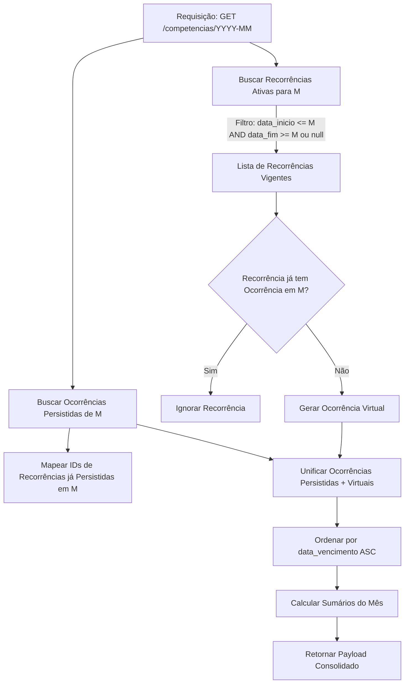

# Product Requirements Document (PRD)

## Aplicação Minimalista de Gestão de Contas a Pagar e Receber

---

## 1. Visão Geral e Proposta de Valor

### 1.1 Contexto e Problema

A maioria das ferramentas de controle financeiro peca pelo excesso: planilhas complexas, categorizações profundas e dezenas de gráficos que geram fricção diária de preenchimento. Usuários individuais buscam frequentemente apenas responder a duas perguntas simples no início de cada mês:

1. *Quais contas vencem este mês e quanto vai sobrar do meu salário?*
2. *Essa conta específica já foi paga ou ainda está pendente?*

### 1.2 Proposta de Valor

Um SaaS **minimalista e opinativo** focado estritamente na previsão e liquidação de fluxo de caixa mensal. O sistema antecipa os compromissos por meio de recorrências e permite ao usuário auditar e liquidar as ocorrências de forma direta, sem configurações burocráticas.

---

## 2. Diagnóstico de Gaps e Decisões de Design (Arquitetura de Produto)

A análise do rascunho inicial identificou seis gaps centrais de concepção que foram solucionados nesta versão:

| Gap Identificado | Risco / Problema | Solução Incorporada no PRD |
| :--- | :--- | :--- |
| **Ausência de Despesas Avulsas** | Na vida real, nem toda despesa é recorrente (ex.: conserto de carro, consulta médica). Se tudo exigir uma recorrência, o usuário criará "recorrências descartáveis". | `id_recorrencia` em `Ocorrência` passa a ser opcional (`nullable`). Se nulo, trata-se de um lançamento pontual naquele mês. |
| **Dias de Vencimento Inválidos (Fevereiro/Meses de 30 dias)** | Se uma recorrência vence no dia 31, em fevereiro ou abril a data quebrará se não for normalizada. | Regra de *clamping*: a data calculada é sempre $\min(\text{dia\_do\_mes}, \text{ultimo\_dia\_do\_mes})$. |
| **Exclusão em Cascata Destrutiva** | Deletar uma recorrência e apagar todas as ocorrências passadas destrói o histórico contábil de meses anteriores já liquidados. | Implementação de encerramento (`data_fim = mes_anterior`) em vez de *hard delete* quando já houver ocorrências liquidadas. |
| **Ambiguidade de Status (`pulado` vs `cancelado`)** | Não estava claro quando usar cada um e faltava o conceito de vencido (*overdue*). | `pulado` aplica-se a uma competência isolada; `cancelado` invalida aquela conta. O status `atrasado` é um estado computado em tempo de execução. |
| **Data Real de Pagamento vs Competência** | A ocorrência só tinha competência. Não permitia saber em que dia a conta foi de fato paga ou se foi paga com atraso. | Adicionado campo opcional `liquidado_em` (data/timestamp). |
| **Fuso Horário e Armazenamento de Datas** | Tratar competências com timestamps UTC pode mover `2026-05-01` para o mês anterior dependendo do fuso do cliente (`-03:00`). | Competência armazenada estritamente como string `YYYY-MM` ou `DATE` fixado sem hora. |

---

## 3. Modelo de Domínio e Dados

### 3.1 Entidade: Recorrência (`recurrences`)

Representa o contrato gerador de eventos financeiros mensais.

```typescript
type TipoTransacao = 'CREDITO' | 'DEBITO';

interface Recorrencia {
  id: string; // UUIDv7
  usuario_id: string; // FK do Better-Auth
  tipo: TipoTransacao;
  descricao: string; // Max 120 caracteres
  valor_padrao: number | null; // Em centavos de BRL (ex: R$ 50,00 -> 5000). Opcional para contas variáveis (ex: fatura do cartão)
  dia_vencimento: number | null; // 1 a 31. Opcional
  data_inicio: string; // Formato 'YYYY-MM-01'
  data_fim: string | null; // Formato 'YYYY-MM-01'. Null = indeterminado
  observacao: string | null;
  ativo: boolean; // Flag para soft delete / desativação
  criado_em: string; // ISO 8601 UTC
  atualizado_em: string; // ISO 8601 UTC
}
```

### 3.2 Entidade: Ocorrência (`occurrences`)

Representa a materialização de uma despesa/receita em uma competência específica.

```typescript
type StatusOcorrencia = 'PENDENTE' | 'LIQUIDADO' | 'PULADO' | 'CANCELADO';

interface Ocorrencia {
  id: string; // UUIDv7
  usuario_id: string; // FK do Better-Auth
  recorrencia_id: string | null; // FK opcional (null se for avulsa)
  tipo: TipoTransacao; // Copiado da recorrência na persistência para integridade
  descricao: string; // Copiado da recorrência ou definido na criação
  status: StatusOcorrencia;
  valor: number; // Em centavos. Obrigatório na persistência
  competencia: string; // Formato 'YYYY-MM-01'
  data_vencimento: string | null; // Calculada ou customizada para o mês específico
  liquidado_em: string | null; // Data efetiva do pagamento/recebimento
  observacao: string | null;
  criado_em: string;
  atualizado_em: string;
}
```

### 3.3 Objeto Transiente: Ocorrência Virtual ("Fantasma")

Objeto em memória retornado pela API para itens ainda não persistidos na competência consultada:

```typescript
interface OcorrenciaVirtual {
  id_temporario: string; // Ex: 'virtual_<recorrencia_id>_<competencia>'
  recorrencia_id: string;
  is_virtual: true;
  tipo: TipoTransacao;
  descricao: string;
  status: 'PENDENTE';
  valor: number | null; // Herda valor_padrao
  competencia: string;
  data_vencimento: string | null;
  liquidado_em: null;
  observacao: string | null;
}
```

---

## 4. Algoritmo de Resolução de Ocorrências do Mês

Para renderizar o extrato da competência $M$ (onde $M = \text{YYYY-MM-01}$):



### Regra de Clamping de Vencimento

Quando a ocorrência for gerada a partir de `dia_vencimento`:
$$\text{dia\_efetivo} = \min(\text{recorrencia.dia\_vencimento}, \text{dias\_no\_mes}(M))$$
$$\text{data\_vencimento} = \text{formatar}(M.\text{ano}, M.\text{mes}, \text{dia\_efetivo})$$

---

## 5. Regras de Negócio Detalhadas

1. **Unicidade de Ocorrência por Recorrência:**
   - Índice único composto no banco de dados: `UNIQUE (usuario_id, recorrencia_id, competencia) WHERE recorrencia_id IS NOT NULL`.
2. **Materialização no Primeiro Toque:**
   - Ao alterar o status de uma ocorrência virtual ou editar seu valor/vencimento, ela deixa de ser virtual e é executado um `INSERT` em `occurrences`.
3. **Imutabilidade e Snapshot Histórico:**
   - Se uma `Recorrência` tiver seu `valor_padrao` alterado em Junho, as ocorrências persistidas de Maio ou anteriores permanecem inalteradas.
4. **Política de Exclusão de Recorrência:**
   - Se a recorrência possuir ocorrências já persistidas: a exclusão direta é **bloqueada**. A API deve sugerir o encerramento da recorrência (`data_fim = mes_atual - 1`).
   - Se a recorrência não possuir nenhuma ocorrência persistida: permite-se o *hard delete*.
5. **Estado Derivado "Atrasado" (*Overdue*):**
   - Não existe valor `ATRASADO` no enum de banco. O frontend e a API calculam o indicador `atrasado: boolean`:
   $$\text{atrasado} = (\text{status} == \text{'PENDENTE'}) \land (\text{data\_vencimento} < \text{hoje})$$
6. **Contas de Valor Variável:**
   - Quando `valor_padrao` for `null`, a ocorrência virtual exibirá valor pendente de definição ($0,00$ ou indicativo visual). O usuário só pode marcá-la como `LIQUIDADO` após informar um valor maior que zero.

---

## 6. Endpoints e Contratos de API (Hono)

### 6.1 Recorrências (`/api/v1/recorrencias`)

- `GET /` — Lista todas as recorrências do usuário (com filtros `status=ativas|todas`).
- `POST /` — Cria uma nova recorrência.
- `GET /:id` — Detalhes de uma recorrência específica.
- `PATCH /:id` — Atualiza metadados (descrição, valor padrão, dia, data fim). Bloqueia edição de `tipo` e `data_inicio`.
- `DELETE /:id` — Executa desativação ou hard delete conforme regras de integridade.

### 6.2 Competências e Ocorrências (`/api/v1/competencias`)

- `GET /:ano_mes` (ex: `2026-10`)
  - Retorna o conjunto unificado (persistidas + virtuais) e o resumo financeiro consolidado:

  ```json
  {
    "competencia": "2026-10-01",
    "resumo": {
      "total_receitas_previsto": 650000,
      "total_receitas_realizado": 650000,
      "total_despesas_previsto": 420000,
      "total_despesas_realizado": 280000,
      "saldo_projetado": 230000,
      "saldo_atual": 370000
    },
    "itens": [
      {
        "id": "occ_123456",
        "is_virtual": false,
        "recorrencia_id": "rec_789",
        "tipo": "DEBITO",
        "descricao": "Aluguel",
        "status": "LIQUIDADO",
        "valor": 220000,
        "data_vencimento": "2026-10-10",
        "liquidado_em": "2026-10-09"
      },
      {
        "id": "virtual_rec_999_2026-10-01",
        "is_virtual": true,
        "recorrencia_id": "rec_999",
        "tipo": "DEBITO",
        "descricao": "Energia Elétrica",
        "status": "PENDENTE",
        "valor": 18000,
        "data_vencimento": "2026-10-25",
        "liquidado_em": null
      }
    ]
  }
  ```

### 6.3 Mutação de Ocorrência (`/api/v1/ocorrencias`)

- `POST /materializar` — Converte uma virtual em persistida ou cria um lançamento avulso.
- `PATCH /:id/status` — Altera status (`LIQUIDADO`, `PENDENTE`, `PULADO`, `CANCELADO`).
- `PATCH /:id` — Atualiza valor, data de liquidação ou observação de uma ocorrência existente.

---

## 7. Requisitos de Frontend e UX Minimalista

1. **Navegador de Competência Centralizado:**
   - Seletor de mês fixo no topo (`< Outubro 2026 >`), permitindo avançar e recuar com um clique ou atalhos de teclado (`←` e `→`).
2. **Barra de Resumo Sintética:**
   - Exibição de 3 blocos: **Entradas**, **Saídas** e **Saldo Restante Estimado**.
3. **Liquidação em 1 Clique:**
   - Botão de checkbox ou ação rápida ao lado de cada linha para alternar entre `PENDENTE` e `LIQUIDADO`.
   - Se a conta tiver valor pendente (nulo), o clique abre um popover inline exigindo apenas o input do valor.
4. **Agrupamento e Ordenação:**
   - Agrupamento visual: **Vencidas / Hoje**, **A Vencer no Mês**, **Liquidadas / Puladas**.
5. **Tratamento Optimistic UI:**
   - Alterações de status no TanStack Query devem atualizar a interface instantaneamente com rollback em caso de falha de rede.

---

## 8. Arquitetura e Engenharia

### 8.1 Estrutura do Monorepo (npm workspaces)

```text
├── apps/
│   ├── web/               # React + Vite + Mantine UI + TanStack Router +  TanStack Query
│   └── api/               # Express
├── packages/
│   ├── shared/            # Schemas Zod, tipos TypeScript, Regras de Negócio e helpers de data
│   ├── config/            # Prettier e Linter
│   └── database/          # Migrations Knex, seeds e conexão Postgres
├── docker-compose.yml     # Postgres 16 local + pgAdmin/Adminer
└── package.json
```

### 8.2 Autenticação (Better-Auth)

- Better-Auth executado integrado ao backend Hono ou como micro-servidor de auth.
- Estratégia de sessão via cookies HttpOnly com middleware no Hono injetando o `usuario_id` verificado no contexto (`c.get('user')`).
- Isolamento estrito de dados (*multi-tenancy* lógico): todas as queries do Knex são filtradas obrigatoriamente por `usuario_id`.

---

## 9. Próximos Passos e Critérios de Aceite para o MVP

- [ ] **M1: Core Domain & Schemas**
  - Implementar pacote `@shared` com schemas Zod para Recorrência e Ocorrência.
  - Implementar migrações do banco no Knex com restrições e índices únicos.
- [ ] **M2: API de Competência**
  - Implementar endpoint `GET /competencias/:ano_mes` com a lógica de junção de ocorrências persistidas e virtuais.
- [ ] **M3: Frontend Minimalista**
  - Criar tela única mensal com navegação de competências, checklist de liquidação e dialog para lançamentos avulsos/recorrentes.
- [ ] **M4: Testes de Integridade**
  - Testes unitários para clamping de datas de vencimento em fevereiro e anos bissextos.
